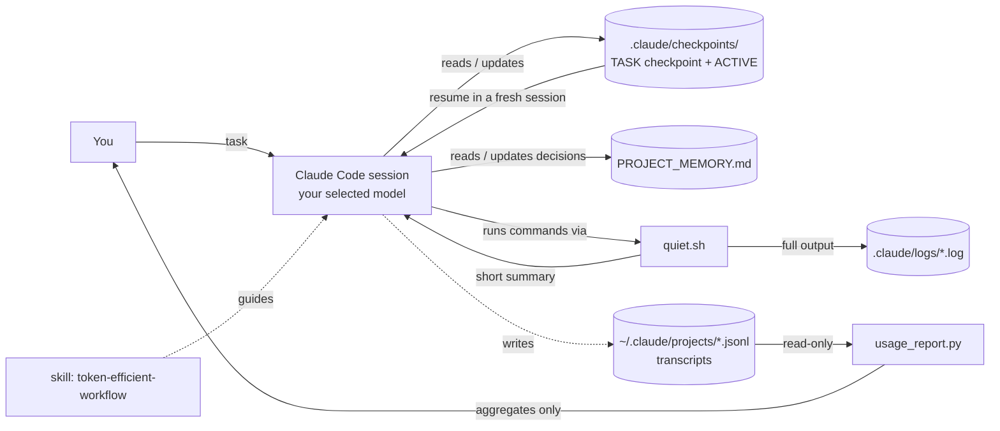

# Claude Code Budget Manager

A lightweight, dependency-free toolkit for **reducing unnecessary token consumption in Claude Code** during
long-running development work, without lowering reasoning quality or test discipline.

It gives Claude a disciplined working style (a skill), gives you durable task state (checkpoints) so sessions can be
reset safely, keeps noisy command output out of the context, and lets you **measure** what a session actually used.

> Token savings are workload-dependent and **not guaranteed**. This toolkit does not increase Claude subscription
> limits, does not change your model and never enables paid API billing.

## What it does
- **`token-efficient-workflow` skill:**
  - bounded stages with measurable acceptance criteria;
  - focused tests before broad suites;
  - quiet command output;
  - at most two attempts per identical failure;
  - no unnecessary subagents;
  - your selected model is preserved (never switched automatically);
  - explicit context-reset recommendations.
- **Two-layer continuity:**
  - **project memory**: architecture, decisions, constraints, rejected approaches;
  - **task checkpoints**: objective, stage, work done, files, tests, failures, next action;
  - a fresh session can resume from files instead of a long conversation.
- **`quiet.sh`:** runs a command, keeps the full log on disk, prints only exit status, test summary, first error and
  a short tail.
- **`usage_report.py`:** a read-only report of tokens, cache reads/writes, thinking tokens, tool calls, errors,
  compactions and duration, per session or per stage window, from local transcripts. It never prints transcript
  content.
- **Safe installer/uninstaller:** idempotent, keeps your edits, never touches `settings.json`.

## What it does not do
- It does not switch models, change settings, store credentials or call any API.
- It does not run background processes or orchestrate sessions automatically.
- It does not guarantee or estimate savings for you: you measure them.

## Architecture


## Requirements
- Claude Code (skills support).
- `bash` for the installer and `quiet.sh`: Linux and macOS; Git Bash or WSL on Windows.
- Python 3.8+ for `usage_report.py` (standard library only).

## Installation
Inspect before you run anything:
```bash
git clone --branch v0.1.0 https://github.com/zieism/claude-code-budget-manager.git
cd claude-code-budget-manager
less scripts/install.sh
scripts/install.sh --dry-run              # shows every action, changes nothing
scripts/install.sh                        # user-level skill + tools
scripts/install.sh --project ~/code/app   # optional: checkpoint templates in a project
```
- Installs into `$CLAUDE_CONFIG_DIR` (if set) or `~/.claude`.
- Re-running is safe (`unchanged`).
- Files you edited are kept unless you pass `--force`, which keeps a backup.
- Manual and Windows instructions: [docs/INSTALLATION.md](docs/INSTALLATION.md).

## Quick start
1. Start a new Claude Code session in your project and say:
   > Use the token-efficient-workflow skill. Task T-1: <your task>.
2. Claude creates `.claude/checkpoints/T-1.md` with stages and acceptance criteria, then works stage by stage.
3. At a stage boundary it tells you whether a fresh session would materially reduce context. To resume later, say
   “resume the active task”.

See [docs/USAGE.md](docs/USAGE.md) for an end-to-end example.

## Measuring usage
```bash
~/.claude/budget-manager/usage_report.py --session <id-prefix> --hide-project
~/.claude/budget-manager/usage_report.py --session <id> --stage build=2026-01-01T09:00..2026-01-01T10:00 --json
```
- `cache_read_per_message` (context re-sent per call) is usually the clearest signal of context growth.
- The report handles Claude Code's one-line-per-content-block transcript layout (usage counted once per response).
- **Token counts are not subscription usage:** check `/usage` in Claude Code.
- How to compare workflows fairly: [docs/MEASUREMENT.md](docs/MEASUREMENT.md).

## Checkpoint recovery
Read `ACTIVE` → the task checkpoint → `PROJECT_MEMORY.md` → `CLAUDE.md`, then continue with **Next action**.
Checkpoints keep what was written down, not every detail of a conversation. See
[docs/CONTINUITY.md](docs/CONTINUITY.md).

## Security and privacy
- No network access, no credentials, no settings changes.
- The report prints aggregates only.
- Checkpoints and `.claude/logs/` may contain project details: review them before committing publicly (the
  installer adds `.claude/logs/` to `.gitignore`).
- Report vulnerabilities privately: [SECURITY.md](SECURITY.md).

## Troubleshooting
| Symptom | Fix |
|---|---|
| Skill not listed | Start a **new** session after installing; check `~/.claude/skills/token-efficient-workflow/SKILL.md` exists (or `$CLAUDE_CONFIG_DIR/...`). |
| Installer exits 3 with `KEEP` | A file differs from this version (your edits or another tool). Review it; use `--force` to replace it (a backup is kept). |
| `usage_report.py` exits 3 | Your Claude Code transcript format is not recognised. Please open an issue with your Claude Code version (no transcript content). |
| `no matching sessions` | Check `--root`, `--session` prefix and the time window (UTC). |
| Windows | Use the manual skill copy and `py scripts\usage_report.py`; shell scripts need Git Bash or WSL. |

## Known limitations
See [docs/LIMITATIONS.md](docs/LIMITATIONS.md):
- no guaranteed savings;
- tokens ≠ plan limits;
- the transcript format may change;
- context resets are manual;
- Windows is untested.

## Uninstallation
```bash
scripts/uninstall.sh --dry-run && scripts/uninstall.sh
```
Removes only unmodified installed files. It never touches settings, your model or project checkpoints.

## Contributing
See [CONTRIBUTING.md](CONTRIBUTING.md): standard library only, synthetic test data only, and no unmeasured savings
claims.

## License
[MIT](LICENSE). It is short and permissive, the norm for small developer tools, and lets anyone adapt the skill and
scripts to their own workflow with minimal friction.
